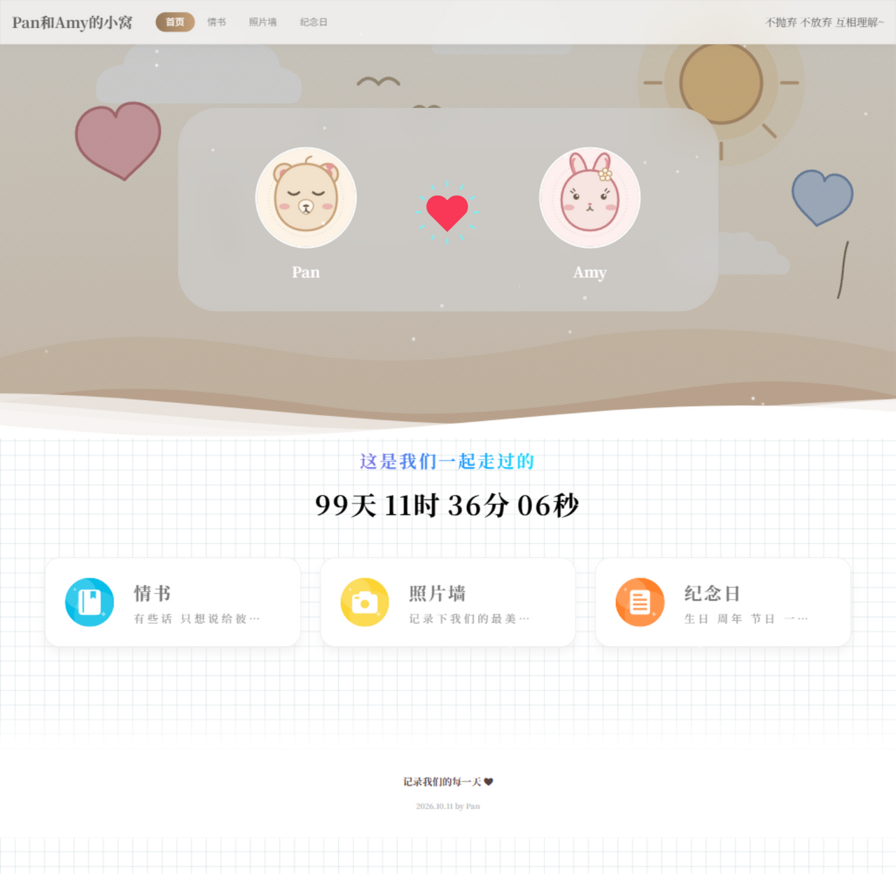
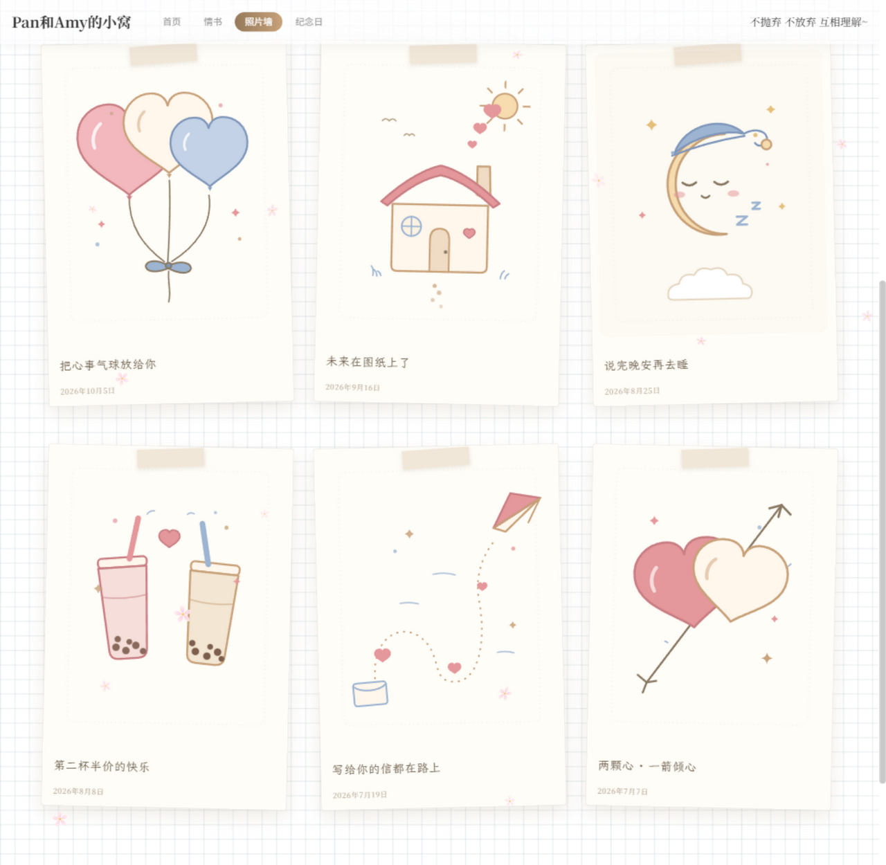
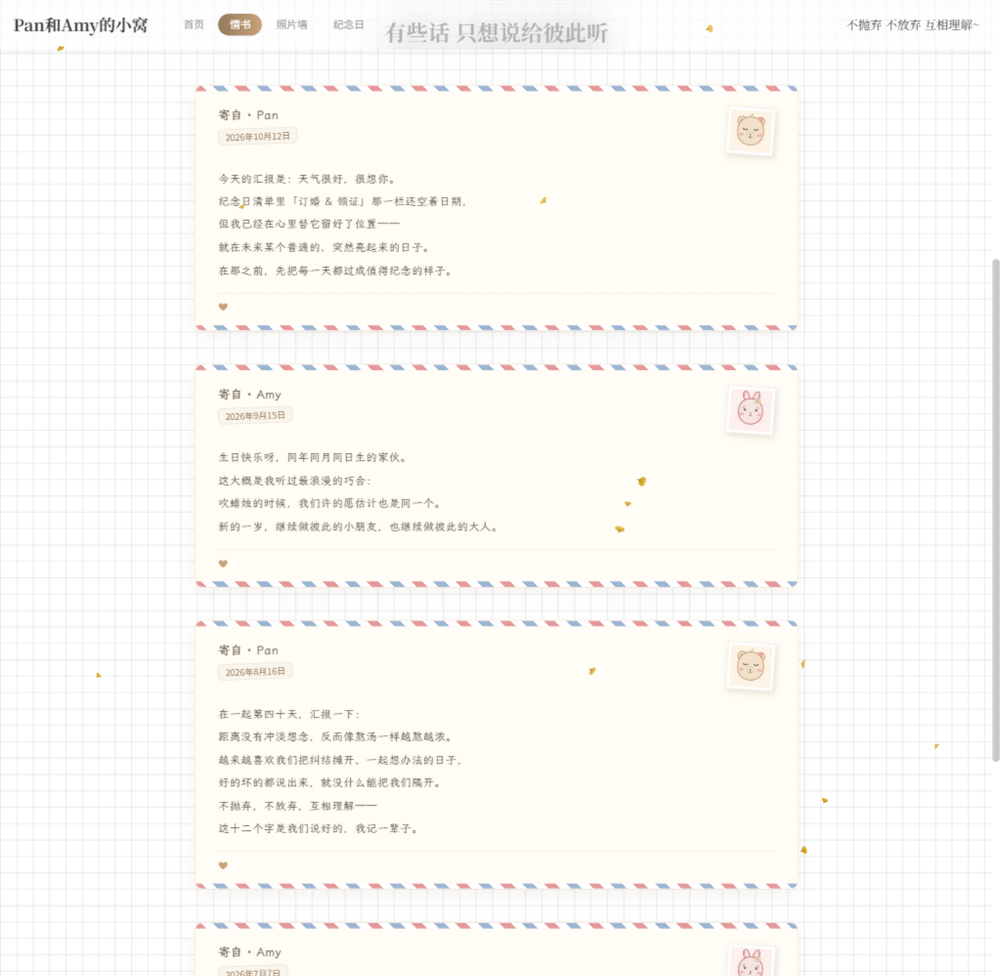
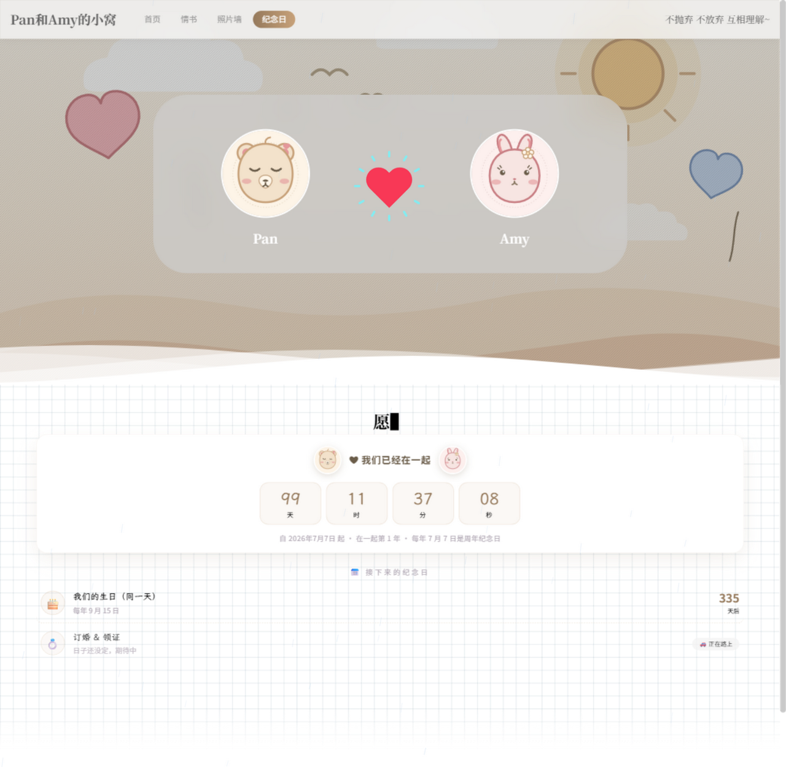

# 💞 our-love-site · Pan和Amy的小窝

> 不抛弃 不放弃 互相理解~

属于两个人的情侣小站：**恋爱计时 · 照片墙 · 情书 · 纪念日**，带一个精致的管理后台。
数据（照片、情书、设置）全部存在自己的服务器上，**不经过任何第三方**。


---

## 📸 界面速览

| 🏠 首页 · 恋爱计时 | 📷 照片墙 · 拍立得手账 |
|:---:|:---:|
|  |  |

| 💌 情书 · 航空信封 | 🎉 纪念日 · 纪念时钟 |
|:---:|:---:|
|  |  |

> 仓库内的照片墙、横幅与头像均为**手绘 SVG 示意图**；部署后登录后台即可换成自己的照片，无需改代码。

## ✨ 功能特性

### 🏠 首页
- 大字恋爱计时器：**在一起 X 天 X 时 X 分 X 秒**，精确到秒实时跳动
- 双头像毛玻璃卡 + 爱心跳动 + 底部波浪动画，背景大图可自定义

### 📷 照片墙
- **拍立得手账风**卡片：微倾斜 + 和纸胶带 + 楷体配文，悬停摆正浮起
- 点击弹出大图灯箱（配文 + 日期标注），自动生成 webp 缩略图省流量
- 后台上传支持**多选 + 拖拽投放区**，可先填本批共用配文，传后逐张修改
- 支持私密锁：上锁后页面与图片直链均需密码（403）

### 💌 情书
- **航空信封**卡片：红蓝斜纹封边、邮票式头像框、邮戳日期、霞鹜文楷手写正文
- 双人署名（分段选择器），可附照片；支持私密锁（密码与相册通用）
- 写信直接在管理后台完成，公开页面纯阅读

### 🎉 纪念日
- **纪念时钟**：天/时/分/秒四块数字砖实时跳动 + 双头像 + "在一起第 N 年"
- 三种类型：每年循环 / 仅一次 / 日子未定（"🚗 正在路上"，补上日期自动变倒计时）
- 临近变橙、当天高亮"今天"；列表悬停浮起

### 🛠️ 管理后台
- 单行分区导航（照片墙/情书/纪念日/设置，平滑滚动+滚动高亮）
- 情书署名分段选择器、照片拖拽投放区、主题色 8 款预设色卡即点即生效、
  图片上传卡片（当前图预览 + 选图即时预览 + 清除开关）、iOS 风格开关、日期时刻胶囊输入

### ✨ 动效
- 飘落特效七种模式：🎲 随机 / 🌸 樱飞（真实花瓣贴图）/ 🌸 樱花 / 🌸 花瓣 / 🌿 银杏 / ❄️ 雪花 / ☀️ 夏日雪 / 🌧️ 雨
- 互动特效：💗 点击飘爱心、💗 爱心拖尾
- 后台「小站设置 → ✨ 动效」即点即用，跟随主题色；遵循系统"减少动态"设置，页面隐藏自动暂停

### 🎨 主题系统
- 后台 8 款预设主题色（淡米/樱花粉/玫瑰粉/抹茶绿/雾霾蓝/薰衣草/陶土橘/酒红）一键切换
- 前台 + 后台所有颜色统一由主题变量驱动，无遗漏

## 🚀 快速开始

```bash
# 方式一：本地运行（Node.js ≥ 18）
npm install
npm start                 # 打开 http://localhost:3000

# 方式二：Docker 部署（推荐，1C1G 小服务器即可）
sudo docker compose up -d --build    # 打开 http://服务器IP/
```

**关于密码**：首次启动会自动生成随机密码写入 `data/初始密码.txt`（后台与私密密码统一）。
本仓库自带的示例数据库密码为 `123456`，**公开部署前请务必登录后台「修改密码」换掉**（最短 4 位）。

## 📁 目录结构

```
our-love-site/
├── docker-compose.yml   # 服务定义（80 端口 → 容器 3000）
├── Dockerfile           # 构建配方（npm 与 better-sqlite3 已配国内镜像）
├── backup.sh            # 备份脚本（数据 + 照片 + 配置，保留 8 份）
├── docs/screenshots/    # README 界面截图
├── CHANGELOG.md         # 变更记录
├── src/                 # 后端：server.js / db.js / routes/{site,admin,images}.js / upload.js / dates.js / util.js
├── views/               # EJS 模板（公开页共用 lg-head/lg-foot；admin/ 后台）
├── public/
│   ├── css/             # style.css（后台样式）+ lightbox.css
│   ├── fonts/lxgw-wenkai/  # 霞鹜文楷切片字体（582 片段 + OFL.txt）
│   ├── img/             # 樱飞花瓣贴图（sakura.png）
│   ├── js/              # effects.js / timer.js / lightbox.js / typewriter.js
│   └── likegirl/Style/  # LikeGirl 样式资产（已裁剪至实际使用部分）
├── data/                # 【数据】SQLite 库、会话密钥、密码备忘
└── uploads/             # 【数据】originals/ 原图、thumbs/ 缩略图、compressed/ 压缩版
```

**全部可变数据只在 `data/` 与 `uploads/`**，迁移备份带走它们（或整个目录）即可。

## 🖥️ 日常使用

- 小站：`http://服务器IP/`　后台：`http://服务器IP/admin`
- 常用命令：

```bash
cd ~/Amy-Pan-Love-Site
sudo docker compose ps               # 状态
sudo docker compose restart          # 重启
sudo docker compose up -d --build    # 改代码后重新部署
./backup.sh                          # 手动备份
```

系统 cron：每周日 04:10 自动备份（保留 8 份）。

## 🔄 迁移到新服务器（三步）

```bash
# 1. 旧服务器打包
cd ~ && tar czf Amy-Pan-Love-Site-migration-$(date +%Y%m%d).tar.gz --exclude='Amy-Pan-Love-Site/backups' Amy-Pan-Love-Site

# 2. 传输
scp Amy-Pan-Love-Site-migration-*.tar.gz ubuntu@新服务器IP:~/

# 3. 新服务器装好 Docker 后解压启动
tar xzf Amy-Pan-Love-Site-migration-*.tar.gz && cd Amy-Pan-Love-Site && sudo docker compose up -d --build
```

**搬家后记得**：① 重加每周备份 cron（见 `crontab -l`）② 云控制台安全组放行 80 端口。
Dockerfile 已内置 npmmirror 与 better-sqlite3 二进制镜像，国内网络可直接构建。

## 🛡️ 技术与安全

- Node.js (Express + EJS) + SQLite + sharp；Docker 单容器部署，实测常驻内存 ~40MB
- 密码 bcrypt；后台登录与私密解锁防爆破（连续错 8 次锁 15 分钟）
- 上传仅限图片、文件名服务端随机化；自动压缩（头像 480² / 背景 1920w / 缩略图 640w webp），原图永久保留
- 手写字体：霞鹜文楷切片自托管（582 片段按需加载，`font-display: swap`，不阻塞渲染）
- HTML 禁缓存（改版刷新即生效），图片/静态资源长缓存

## 📄 版权与致谢

- 页面样式：[Like Girl v5.2.0](https://github.com/kikiw-io/like-girl) by Ki（开源项目，仅个人使用，禁止出售）
- 手写字体：[霞鹜文楷 LXGW WenKai](https://github.com/lxgw/LxgwWenKai)（SIL OFL，OFL.txt 已随字体保留）
- 变更记录见 [CHANGELOG.md](CHANGELOG.md)

---

Made with 💞 by Pan & Amy
